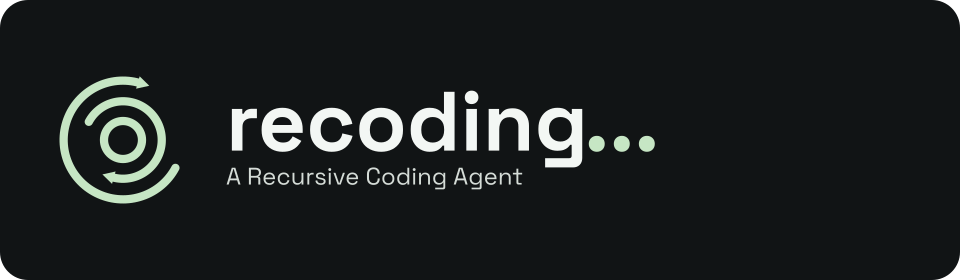
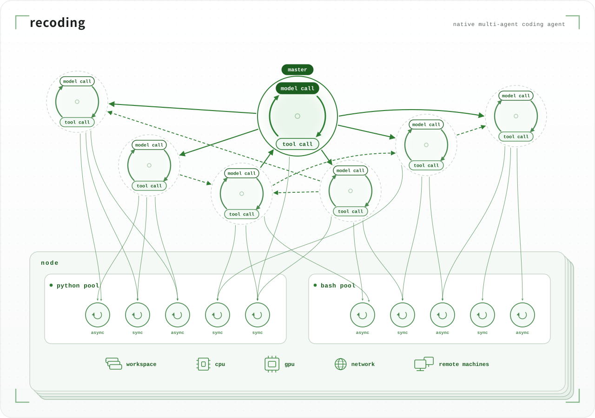
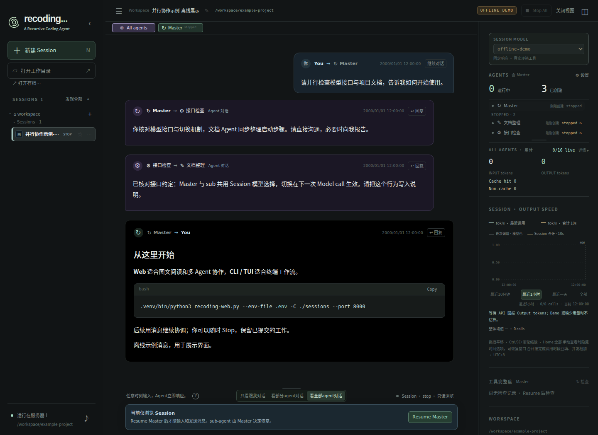
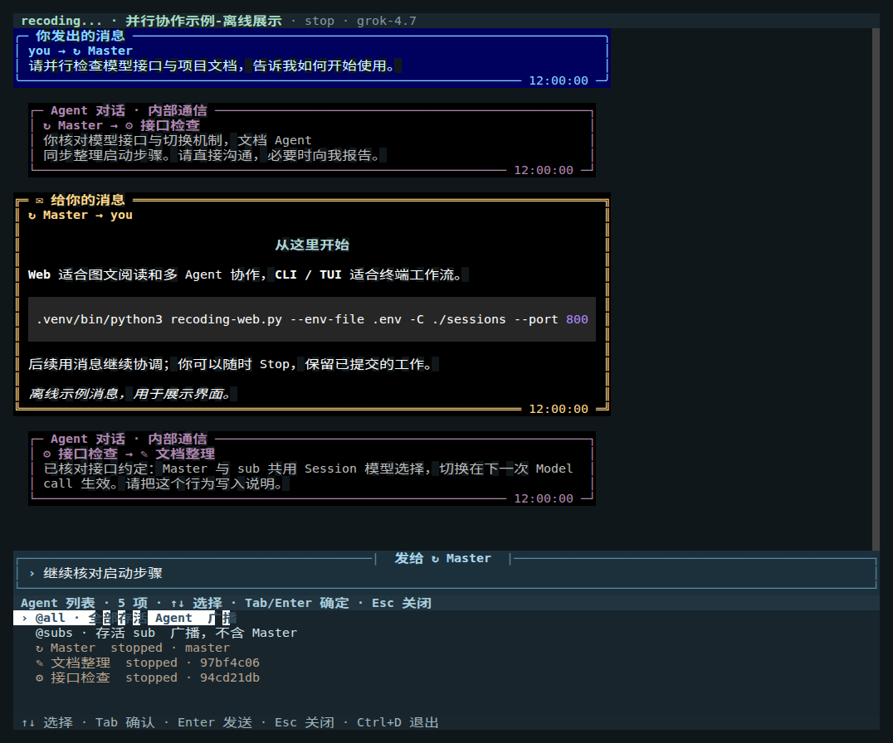

# OpenRecoding

[中文](#chinese) · [English](#english)

 

OpenRecoding 是一个以持续运行的 Agent 团队为核心的 Coding Agent。它通过消息组织协作，使用本地与远端 Node 上的进程池执行代码，探索和解决复杂问题。

- **Agent 的生命周期独立于任务。** 每个 Agent 都有独立的 Context 和 Endless Agent Loop，持续进行 `Model call → Tool call → Model call`。完成一次回答或一个子任务后，它可以继续协调、处理后续工作，或通过 `sleep` 休眠等待。
- **统一消息输入，显式通信输出。** 用户指令、同伴消息和异步工具完成通知进入同一个收件箱，在下一次 Model call 前读取；新消息可以立即唤醒休眠中的 Agent。普通模型正文用于过程说明，给用户的报告和 Agent 之间的通信都通过消息工具显式发出。
- **Master 集中治理，Agent 对等协作。** Master 负责创建、停止和恢复 Agent；Agent 之间通过消息直接交换任务、进展和结果。Master 可以按需读取或监听全局消息，组织协调；用户也可以直接与任意 Agent 对话，并查看团队之间的交流。
- **认知与执行分离，分别组织并行。** 多个 Agent 并发推理，多个 Node 并行使用计算资源，每个 Node 内的 Python / Bash 进程又可并发执行。同步 / 异步与持久 / 临时独立组合；多个 Agent 可以复用同一持久进程，需要保留的进程可在 Owner 停止前显式转交。

## 第一次递归：用一个coding agent打开这个coding agent

打开你喜欢的 Coding Agent，例如 Codex、WorkBuddy / CodeBuddy。

第一步：给你的coding agent如下指令
> 请从 <https://github.com/jiaxz/open-recoding> 下载项目。

第二步：进入 `open-recoding` 目录，让你的coding agent在此创建新对话，给出如下指令
>理解这个项目，告诉用户这个项目能做什么，做好运行前的准备工作，告诉用户如何启动。

 

\-- 目前 OpenRecoding 只能在 Linux 中运行，如果你不是linux，或许你的coding agent可以帮你搞定一切\~\~

 

## 第二次递归：如果你对这个coding agent不满意，就让另一个coding agent改进它

随你所愿，随心所愿~~

 
 

## 界面预览

**建议优先使用 Web 界面。** 它更方便阅读图文内容、查看多个 Agent 的对话，以及管理 Session 和计算资源。

### Web

用于图文阅读、多 Agent 对话、Session 管理和运行观测。操作见 [Web 使用指南](docs/guide.md)。

### CLI / TUI

终端里的全屏聊天界面，输入框固定在底部，通过 `@` 和 `/` 选择对象、查看消息和管理任务；也支持 Shell 脚本调用。操作见 [CLI 使用说明](docs/cli.md)。

*截图使用真实界面渲染器和合成离线消息，不代表实际模型报告。*

## 文档目录

完整导航与阅读顺序见 [文档首页](docs/index.md)。

| 文档                                                                 | 内容                            |
| ------------------------------------------------------------------ | ----------------------------- |
| [理解项目](docs/understanding.md)                                      | 写给 AI 的项目概览、能力与逐步阅读路线         |
| [首次初始化](docs/first-run.md)                                         | 环境、依赖、API、必要目录和最小验证           |
| [Host Coding Agent 维护](docs/host-maintenance.md) | 项目、packages、tools、Session 与 context 压缩 |
| [配置与启动](docs/configuration.md)                                     | Web / CLI 启动命令、模型与运行参数        |
| [Web](docs/guide.md) · [CLI / TUI](docs/cli.md)                    | 界面、消息、Session 与操作说明           |
| [从 Python 调用](docs/python-session.md)                              | 在程序中使用 Session 核心             |
| [架构](docs/architecture.md) · [多 Agent](docs/sub-agents.md)         | 目录、对象、loop、通信和Python Pool       |
| [工具与沙箱](docs/tools-and-sandbox.md)                                 | 持久 Python / Bash、图片、包、网络和 GPU |
| [运行与数据](docs/session-ownership.md) · [存档](docs/session-storage.md) | Host 协议、锁、恢复、移动与备份            |
| [模型 Context](docs/context.md) · [观测与诊断](docs/observability.md)     | 历史、预算、用量、缓存、速度和排查             |
| [开发维护](docs/development.md) · [常见问题](docs/troubleshooting.md)      | 定向检查、打包与故障处理                  |

## 许可证

本项目采用 [MIT 许可证](LICENSE)。随项目分发的第三方组件保留各自的许可证和版权声明。

---

# English

[中文版](#chinese)

*The Chinese version above is the source of truth. This English version is kept in sync with it; the rest of the documentation is currently in Chinese.*

 

OpenRecoding is a Coding Agent built around a continuously running team of Agents. It coordinates collaboration through messages and uses process pools on local and remote Nodes to execute code, explore, and solve complex problems.

- **An Agent's lifecycle is independent of its tasks.** Each Agent has its own Context and Endless Agent Loop, continuously following `Model call → Tool call → Model call`. After answering a question or completing a subtask, it can keep coordinating, take on further work, or wait using `sleep`.
- **Unified message input, explicit communication output.** User instructions, peer messages, and asynchronous tool-completion notifications enter the same inbox and are read before the next Model call. New messages can immediately wake a sleeping Agent. Ordinary model text describes the current step; reports to users and communication between Agents are explicitly sent through messaging tools.
- **Centralized governance by Master, peer collaboration among Agents.** Master creates, stops, and resumes Agents. Agents exchange tasks, progress, and results directly through messages. Master can selectively read or listen for global messages to coordinate the team; users can also talk to any Agent directly and follow conversations across the team.
- **Separate cognition and execution, with concurrency at each level.** Agents reason concurrently, Nodes use compute resources in parallel, and Python / Bash processes within each Node can also run concurrently. Synchronous / asynchronous invocation and persistent / temporary process lifetime are independent choices. Multiple Agents can reuse the same persistent process, and ownership of a process worth keeping can be explicitly transferred before its Owner stops.

## First recursion: use a Coding Agent to open this Coding Agent

Open your favorite Coding Agent, such as Codex, WorkBuddy / CodeBuddy.

Step 1: give your Coding Agent this instruction:

> Download the project from <https://github.com/jiaxz/open-recoding>.

Step 2: enter the `open-recoding` directory, start a new conversation with your Coding Agent there, and give it this instruction:

> Understand this project, explain to the user what it can do, prepare it for running, and tell the user how to start it.

 

OpenRecoding currently runs only on Linux. If you use another platform, perhaps your Coding Agent can help you work it out.

 

## Second recursion: if you are not satisfied with this Coding Agent, let another Coding Agent improve it

Make it work the way you want.

 
 

## Interface previews

**We recommend starting with the Web interface.** It makes it easier to read text and images, follow conversations across multiple Agents, and manage Sessions and compute resources.

### Web

For reading text and images, multi-agent conversations, Session management, and runtime observation. See the [Web guide](docs/guide.md).

### CLI / TUI

A full-screen terminal chat interface with a fixed bottom input area. Use `@` and `/` to choose recipients, read messages, and manage work. Shell scripting is also supported. See the [CLI guide](docs/cli.md).

*Screenshots use the actual interface renderers and synthetic offline messages; they do not represent real model reports.*

## Documentation

See the [documentation index](docs/index.md) for the full navigation and suggested reading order. The linked documents are currently in Chinese.

| Document | Contents |
| --- | --- |
| [Understand the project](docs/understanding.md) | Project overview, capabilities, and a step-by-step reading path for AI |
| [First-run setup](docs/first-run.md) | Environment, dependencies, API configuration, required directories, and minimal verification |
| [Host Coding Agent maintenance](docs/host-maintenance.md) | Maintaining the project, packages, tools, Sessions, and Context compression |
| [Configuration and startup](docs/configuration.md) | Web / CLI startup commands, models, and runtime options |
| [Web](docs/guide.md) · [CLI / TUI](docs/cli.md) | Interfaces, messages, Sessions, and operations |
| [Use from Python](docs/python-session.md) | Calling the Session core from a Python program |
| [Architecture](docs/architecture.md) · [Multi-agent collaboration](docs/sub-agents.md) | Directories, objects, loops, communication, and the Python Pool |
| [Tools and sandbox](docs/tools-and-sandbox.md) | Persistent Python / Bash, images, packages, network access, and GPU |
| [Runtime and data](docs/session-ownership.md) · [Archives](docs/session-storage.md) | Host protocol, locks, recovery, moving Sessions, and backups |
| [Model Context](docs/context.md) · [Observation and diagnostics](docs/observability.md) | History, budgets, usage, caching, speed, and troubleshooting |
| [Development](docs/development.md) · [Troubleshooting](docs/troubleshooting.md) | Focused checks, packaging, and issue diagnosis |

## License

This project is licensed under the [MIT License](LICENSE). Bundled third-party components retain their respective licenses and copyright notices.
