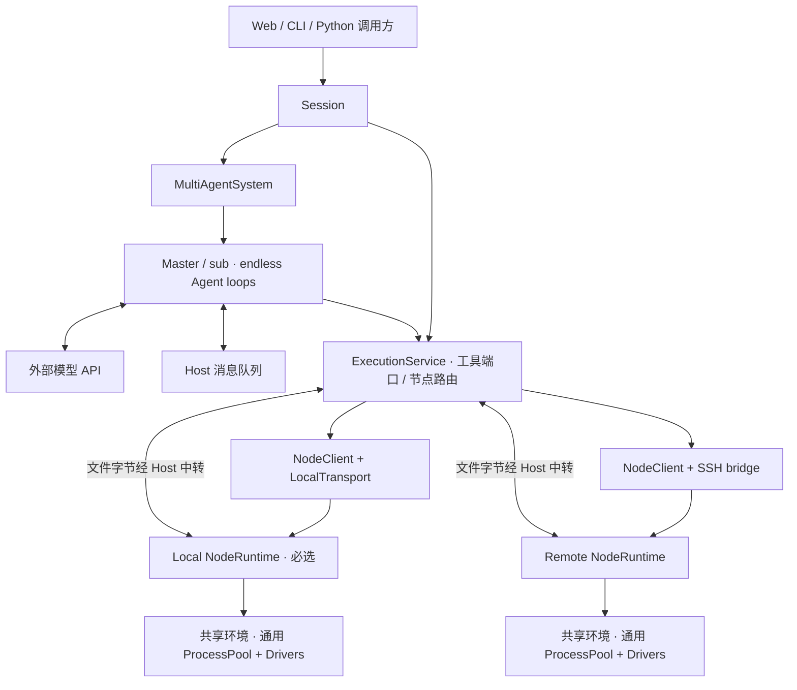

# Recoding 架构与源码地图

[文档目录](index.md) · [阅读路线](understanding.md) · [维护约定](../AGENTS.md)

本文记录当前架构。修改时原位维护，区分已实现能力与演进边界，不追加机器相关的维护流水账。Recoding 使用 **多 Agent 控制平面 + 多 Node 执行平面**；对外的聚合对象是 Session，Web/CLI 是 Session Host。

## 控制平面与执行平面

控制平面运行在 SessionHost 所在机器。Master/sub 各有独立模型历史、收件箱和 endless Agent loop，通过消息协调任务；外部模型 API 提供推理。当前每个 Agent 有一个 Host worker 子进程，并非全部 loop 在同一个 OS PID 内。Context、消息、委派权限、配置与归档由 Host 管理；进程 Owner 与运行队列的权威状态由 Node 管理。

执行平面由 NodeRuntime 承载：一个 Session 在每个 Node 上有一个 Runtime 和一个 workspace，所有 Agent 共用该节点的执行环境与语言进程池。每个 NodeRuntime 可以使用默认 sandbox 或显式 direct Host 模式，接入方式与隔离方式分开选择。SSH 接入不意味着取消沙箱，也不复制另一套 Bash/Python 实现。

控制平面会处理序列化、图片、日志、压缩和可信文件中转，有本机 CPU/内存/I/O 开销；它不执行模型生成的任意程序，也不能被描述为没有安全风险。Builtin 可以直接调用 Host 的进程创建/关闭等系统指令：Agent worker 是控制平面进程，Bash/Python 任务进程是 Node 资源，按职责区分。



## 对象与生命周期

| 对象 | 责任 |
| --- | --- |
| Session | 团队、节点资源、设置、认知存档、整体 Stop/Resume 与维护 |
| SessionHost | 正式外壳的持有进程，遵守 [独占协议](session-ownership.md)；HTTP 只是 GUI 传输 |
| Agent / AgentLoop | 独立推理与消息消费；循环顺序不依赖 Node 实现 |
| ExecutionService | Host 侧唯一工具网关，统一委派权限、资源查找、通知与多节点投影 |
| NodeResources | 一个节点的 Host 侧环境/工具适配器组合，保存该节点进程与执行元数据 |
| ExecutionEnvironment | 管理节点连接、执行环境、能力和工具检查的生命周期；不持有模型历史 |
| NodeClient | 共用请求/响应、受管操作、取消、状态与日志协议 |
| NodeRuntime | 节点侧 supervisor，真正执行工具、排队、跟踪进程并回收资源 |
| Process / Execution | 某节点的语言进程 / 一次代码提交；sync/async 与持久/临时相互独立 |

`local` 固定必选：创建/Resume 运行 Session 时启动并检查就绪；失败不允许 remote-only 或自动降级。Python/Bash 工作进程仍按需创建。纯浏览停止存档不启动任何 Runtime。

Agent 不绑定某台 Node。一个 Agent 可以使用多个节点/进程，多个 Agent 也能使用同一个进程。进程创建后位置固定；转交 owner 只改变逻辑管理责任，异步结果仍给提交者，不搬移内存、不取消或重放已有工作。Master 管理本 Session 所有池资源。

## 目录与依赖

```text
core/
  multiagent/                 统一认知运行时；Master/sub 共用实现
    system.py                 全部 Agent 的创建/持有、角色权限、消息路由与生命周期
    agent.py                  Host 侧 Worker 进程控制、用户提交与运行视图
    worker.py                 WorkerRuntime：IPC、模型/Context 装配和执行观察
    loop.py                   纯 Model call → Tool batch 循环及窄接口
    messages.py               持久收件箱、唤醒、结构化信封与全局消息观察
    events.py                 统一状态推导、事件流、统计投影和启动进度
    prompts.py                System 组装、基础与角色提示
    tools.py                  全部 builtin schema、校验、说明元数据和工具分发
    client.py / chat_stream.py  模型协议、HTTPS、重试和 SSE
    model_config.py / models.py  模型配置、资料与跨模型历史投影
    context_window.py / context_maintenance.py  预算、压缩投影与后台摘要
    storage.py                Context 检查点、日志、锁、图片资产与成员存储
    image_reader.py / media.py / multimodal.py  受限图像读取、展示与模型图像输入
  session/                    对外 API、存档/只读投影、Host 协议与维护
    session.py                装配工具与节点资源
    saved.py / executions.py  停止存档与全节点执行投影
  node/                       执行基础设施；不导入 Agent/团队/Session/Apps/tools
    service.py                Host 执行网关与每节点资源组合
    environment.py            节点连接/执行环境生命周期
    client.py / protocol.py   共用协议与请求处理
    runtime.py                节点侧 NodeRuntime supervisor
    build.py                  注入可信工具运行源码
    transports/local.py       本地启动、管道、进程与 namespace 回收
    transports/ssh.py         同一远端 Runtime 的 SSH 连接与重连
    backends/                 sandbox、direct Host、remote 控制代理
    deployment.py             版本化最小远端部署
    remote_server.py / bridge.py  远端租约、单控制者与私有 socket 桥接
    process_pool.py           Node 权威进程/执行状态、Owner、FIFO 和回收
    pool_client.py            Host 投影、RPC 与通知
    files.py / file_port.py / file_relay.py  文件端点与 Host 中转
    logs.py / log_cache.py / records.py     日志、Host 缓存和进程记录
    capabilities.py           实际节点资源信息
    packages.py / gpu.py / inventory*.py   节点依赖、GPU 和工具检查
  tools/                      正式 non-builtin
    registry.py               定义、schema、源码校验与装配
    python/ / bash/  模型接口、语言 Driver 与 worker
    file_transfer/            transfer_files 与 Host 中转生命周期
    nodes.py / pool_status.py 节点和全局资源查询 schema
    view_image/               图像检查适配
apps/
  web/recoding_web/            GUI Session Host、HTTP/SSE、页面
  cli/recoding_cli/            单 Session Host、TUI 与 shell 控制
maintenance/                  Host Coding Agent 的维护工具
```

认知包依赖为 **Apps → Session → multiagent**；包内由 `MultiAgentSystem` 组合 `Agent` / `AgentLoop`。Session 额外组合 node 与 tools；工具适配器可以调用节点协议，node 不反向导入具体工具。Session 注入适配器 factory、权限查询、通知出口、registry 和运行源码。NodeRuntime 获得选定的执行处理器，不获得认知对象或 Python 回调。

`tools/execution` 已撤销，没有旧路径兼容包。当前发行包含 multiagent、session、node、tools 和两个 Apps 包，不保留 agent 包或旧导入兼容层。正式使用从 `from session import Session` 开始；内部纯 loop 可独立测试。

## 团队拥有 Agent 和事件出口

`MultiAgentSystem.agents` 是唯一运行实例集合，包含 `master` 与当前已创建的 sub worker。Master/sub 通过同一工厂构造，均从未启动实例开始；sub 登记后才启动，失败与 Stop 竞态仍等待资源回收。Master 是其中具有管理权限的 Agent；不扩大 sub 权限，不改变用户 Resume 只启动 Master 的规则。

Host 侧 `Agent` 必须属于一个团队，通过 `team` 和 `agent_id` 直接访问收件箱、提交真实用户消息和上报事件。不再注入 input_sink、host_request、on_event 等平行回调，也不保留独立 Agent 的第二套消息与工具路由。团队唯一持久消息日志提供各 Agent 的 Mailbox 视图，Mailbox 不另存一份 inbox/outbox。对外使用 Session；需要无 Session 的认知运行时可装配 MultiAgentSystem。

团队直接持有每个 Agent 的 `EventStream`，统一由 emit 发布。Session 的订阅来自团队根流，Master 自身事件复用这个流；sub 的日志经带 agent_id 的 agent_event 汇入根流。活跃、停止留言和恢复发布共用同一流及序号，Session 不再手工写子 Agent 日志。

Worker 请求路径为 `Worker JSON RPC → Agent._coordinate → team.dispatch`。Builtin 协作、消息、sleep 和生命周期在团队内部完成，权限与参数校验仍由协调器执行；成功回执在此派生模型精简视图。只有执行资源与 Context 维护继续交给 Session 注入的 `resource_request`，团队不导入 node/tools/session。Session 的资源处理器不再转发协作请求；资源停止仍经 release_owner 通知 Session。

Agent 在构造时根据角色装配 schema、工具权限和 System 片段，不再由团队在构造后设置多组回调。最终 System 仍由 prompts.py 组装；Session 只提供环境约束。`AgentLoop` 保持纯循环，通过模型、工具和输入等窄接口运行，不引用所属团队。Host 对象间直接关联不改变 Worker/IPC、独立 Context 或完整工具批次边界。

每个 Agent 只有一份团队持有的 record。Master 在 index.master，sub 在 index.agents；两者具有相同的生命周期字段。Agent.record 直接引用它，status/run_id/error/sleep 是这个字典的属性视图，不在控制器中另存或同步；事件状态推导、准入、工具 Actor、列表与持久化均读写此记录。Worker 的 Context 与执行位置仍保存在自身检查点中。

Master/sub 共用 start_agent、_launch、finish 的启动/停止/失败和回收屏障。停止先标记 stopping、取消请求，等待在途构造、Node 资源和 Worker 回收完成才变为 stopped/failed；回收未完成不得 Resume。Master 的控制器和存档锁随 Session 保留，sub 的控制器关闭并释放名额。模型管理仍只允许操作 sub，用户 Resume 仍只恢复 Master。

用户输入、Agent 回复、Peer 和系统消息都写入 index.messages。published/deferred 仅是同一记录的投递状态，不维护第二份 outbox 或延后通知数组；Mailbox 只提供目标过滤、未提交读取与唤醒。_publish_message 统一人机消息与系统通知的入队展示、恢复和幂等边界；发布成功再标记，崩溃后按持久 message ID 检查既有事件，避免重复。Peer 的发送与读取展示仍对应实际工具完成和 drain 边界，经同一 emit 出口写入，不在入队时伪造已读。停止 Agent 留言不启动 Worker，慢构造期间的发布在注册后补齐。当前 v5 旧派生索引由 load_team 归一化；只读浏览不写回，Resume 时保存统一索引，原始 Context 与图片不改写。

`WorkerRuntime` 将一次 Run 的模型、Context、收件与统计收拢到一个对象；每个 Worker 只启动一次 Run，Resume 创建新 Worker。先加载已提交的压缩投影，再执行一次 drain 获取最新消息、Session 模型与休眠设置，按同一请求内容记录预算并申请后台压缩；不再并行推送另一份模型选择，也不等待摘要完成。模型请求发出后的新消息留给下一次调用。

Peer 消息在自身历史中保留正文与结构化 `_agent_message` 信封元数据，Worker 直接生成 READ/接收事件，不从展示正文重新解析 JSON。`_model_content` 继续提供相同的模型精简视图，私有字段不发 API；旧已提交历史保持原样。工具由单个 HostTools 校验和分发，在参数副本上剥离本步说明；recall_context 本地处理且检查自身权限，其余调用经 RPC，角色权限仍由团队再次核验。

## 三层并发

1. Agent loops 并发 Model calls，承担任务分解、独立推理和综合。
2. 多 Node 并发，使用不同计算目标；多个逻辑 Node 也可能共用物理硬件。
3. 每 Node 多进程并发；同一持久进程 FIFO，内部仍可使用线程、多进程或异步 I/O。

三者独立，性能收益取决于依赖、数据传输、限流与争用，不能把三个并发数直接相乘。Master/sub 提示鼓励组合有效并行，并管理 CPU/GPU/内存/连接/API 预算。资源探测报告可见 CPU、物理内存、workspace 可用磁盘和 GPU 信息，不代表已实施 cgroup 配额。

## 单 workspace 与 Local 存档

每个 `(Session, Node)` 只绑定一个 workspace，不支持单节点多工作根。Local workspace 还保存权威 Session 归档：

```text
local-workspace/
  项目文件
  .recoding/
    <session>/                历史、消息、设置、锁、节点与执行投影
      remote-nodes.json       连接引用与远端目录；不含私钥正文
      nodes/<node-id>/        对应节点的池记录及已获取日志缓存
    runtime/                  本 workspace 的共享辅助包与执行数据

remote-workspace/
  项目文件
  .recoding/runtime/
    node-code/<build-hash>/   校验后的最小执行代码
    nodes/<session>/<node>/   Runtime 锁、诊断和身份记录
    python-packages/          本节点 workspace 共享辅助包
```

远端执行记录不是第二份认知 Session，不进入侧栏目录发现。添加节点不自动复制项目文件。目录移动仍遵守现有本地归档与 workspace 绑定；远端路径不会随本地移动自动重写，使用前需重新校验。

包和缓存按实际节点建立：workspace 包由本节点项目 Session 共用，home `~/.recoding/cache` 由该机器用户共用；不跨机器直接复制二进制 site-packages。默认 sandbox 映射 `/workspace`，direct 使用真实路径。详见 [包环境](packages.md)。

## SSH Runtime 接入、重连与失联

Host 使用其 SSH 配置认证，按内容摘要传输 **node 源码 + 选定工具执行源码**，无需远端安装 Recoding Apps 或 Agent。包不含模型 API key、`.env`、Context、消息、图片或控制端用户目录内容。远端需兼容的 Linux、Bash、Python 3.10+；sandbox 还要求可用 Bubblewrap。

远端每 `(Session, Node)` 持有一个 Runtime 锁和一份运行环境；不是机器级常驻守护服务。SSH 前台 bridge 连接同用户私有 Unix socket，核验随机 token、协议、Session/Node/runtime 身份。凭据只由 Host 对象持有，不进入模型/界面投影。默认沙箱隐藏 Runtime 部署代码和控制元数据，模型任务不能改写它们。

- 短暂 SSH 通道中断：连接回原 runtime_id，保留执行与内存；不重新部署第二个 Runtime，不重放代码。
- 显式重新连接：优先连接原 Runtime；仅在远端探测确认锁已释放后才创建新代际，并通知 Master 旧内存已丢失。连接异常与恢复会做去重状态投影，失联向 Master 发可信通知。
- 提交失去确认：记录 unknown 和原 Execution ID，恢复后查询；未知不等于失败、完成或已取消。
- 默认租约 **60 秒**，可配置 10–300 秒；Host 的控制/状态请求续约。Host 死亡或长期失联且无请求后，远端回收环境与任务进程。
- 同一远端 Session/Node 的内核锁随 Runtime 进程退出释放。新 Host 不接管旧 token 或隐式恢复内存；旧租约尚未释放时，连接可能被拒绝，需要等待其释放。
- 正常 Session Stop：停止 loops、取消传输、关闭所有节点资源与 Runtime。远端不可达时只能记录未确认回收并由租约兜底，不能声称即时清理已确认。
- Resume：必启 Local，恢复远程绑定和历史描述；远端按连接/使用建立新 Runtime，不恢复内存、不重放旧代码。创建/Stop/取消节点启动通过登记和等待协调，迟到启动不能加入已停止 Session。

连接方式与执行隔离是独立维度；当前远程工具调用仍保留 Session/Agent 的 network 委派门槛。sandbox/direct 不自动相互降级。Host 直接执行和进程组清理不能提供 PID namespace/cgroup 同等级的隔离保证，见 [执行模式](execution-modes.md)。

## 工具、寻址与文件/日志

Builtin 属于 Host 控制机制，当前 13 项涵盖 Agent 管理、消息、sleep/全局观察、自身历史读取。非 builtin 包括进程池、文件/编辑/导航、看图、包、list_nodes、pool_status 和 transfer_files。Agent worker 使用 Session 注入的环境信息，启动不查询 Node；生命周期可以调用 Host 创建/关闭进程等指令。

新进程或路径工具可以指定 node_id，默认 local；已有 process_id/execution_id 自动定位节点。显式指定冲突节点会拒绝，断线时不改到 local 重跑。list_nodes 只返回公共绑定/能力信息；pool_status 为具备工具的 Agent 提供全节点有界资源元数据，不返回代码、context 或日志正文。

所有节点间文件复制由 Host 分块转流：源 Runtime → Host → 目标 Runtime，远程节点无需互通。文件正文不进入模型 Context；版本/SHA-256 校验通过后逐文件原子发布，目录可能部分完成。同步/异步、进度和取消见 [文件传输](file-transfer.md)。

运行中的日志通过节点 RPC 读取，控制端不假定能打开远端路径。已读取的远端日志写本地存档缓存；停止浏览只读此缓存，不连接节点。尚未读取的远端日志可能未归档，返回 cache_only/remote_more_available 明确说明，不能把部分缓存冒充完整日志。

view_image 在目标节点读取图像字节，经 Host 保存不可变资产。发送给人/peer 的 Markdown 图片仍读取 Local workspace，远端生成图应先 transfer_files 回 Local，再发送。展示图片不自动进入模型视觉 context，主动 view_image 与用户粘贴规则保持不变。

## Web 与 CLI

右栏顶部 SESSION RESOURCES 将模型与附加远程节点合并。没有远程节点时只有紧凑添加入口；界面不显示 Local 选择/开关。添加需节点名、Host 的 SSH 目标、远端目录与执行模式，可指定解释器和服务器 SSH 配置引用。浏览器不访问本机文件系统或执行 SSH。

运行 Session 可以动态连接、添加和移除远端绑定；有存活进程或传输时需先清理。停止存档只展示元数据，禁止提前写入设置或发起连接。添加失败不把半初始化节点列为可用，取消/全局 Stop 会回收启动资源。Session 模型对所有 Agent 共用，新节点通过系统消息通知 Agent；当前 Model call 不被改写。

工具卡、进程行和日志来源只为远程加节点名，本地保持原样。Agent tab 和模型调用属于 Host 认知活动，不绑定单个执行节点。节点状态走现有 Session SSE，不增加每节点/每 Agent 订阅。

CLI 继续直接调用 Session，恢复存档时能使用保存的远端绑定；Web/CLI 各自的 Host 独占协议不变。GUI Host 可持有多个 Session、只连接一个页面；CLI 同时持有一个运行 Session。

## 尚未实现的边界

Kubernetes 接入、单节点多目录、通用 Process↔Process RPC、跨 Host 重启接管旧执行内存、自动项目同步均未实现。程序可以按任务自行构建网络服务，但不等于进程中的任意函数自动成为 RPC 接口。

原生多 Agent 消息、Context 压缩、模型切换和展示投影没有因节点重构改变：loop 仍为 Model call → 完整 Tool batch → 下一 Model call，无工具响应补 sleep。详细契约见 [多 Agent](sub-agents.md)、[Context](context.md)、[Host 协议](session-ownership.md)。

## 验证

默认只运行与修改相关的必要检查，不例行全量。可使用 `tests/ssh_support.py::local_ssh` 创建真实 OpenSSH 临时节点：仅监听 loopback、独立端口/密钥/known_hosts/工作目录，无需修改系统 SSH 配置。它是同机 SSH 端点，不是独立物理机或完整 VM；不能据此证明异构平台兼容。

`tests/test_node_runtime.py` 验证真实节点并行、状态、重连、owner、文件中转、日志缓存与租约回收。测试创建的数据统一在 sessions/tests，结束先关闭进程与服务再自动清理；需保留的实测报告放忽略的 .recoding/maintenance。命令见 [开发检查](development.md)。


## Node 通用 Process Pool

每个 NodeRuntime 只有一套语言无关 ProcessPool。节点维护 Owner、名字、FIFO、Execution、取消/超时、退役和回收的权威状态；Python/Bash 工具提供 Driver 与模型 schema。Host PoolClient 仅做增量投影和通知，不维护第二份调度队列。具体契约见 [执行池](execution-pool-design.md)。

Agent 自主经工具端口使用 Node；MultiAgent 负责 Agent 生命周期和通信。Session 将 Agent 停止事件转给各 Node。所有存活 Agent 可使用/读取全部进程；Owner/Master 管理名字、转交和删除，异步结果归提交者。Owner Stop 不再自动移交，详见统一契约。
