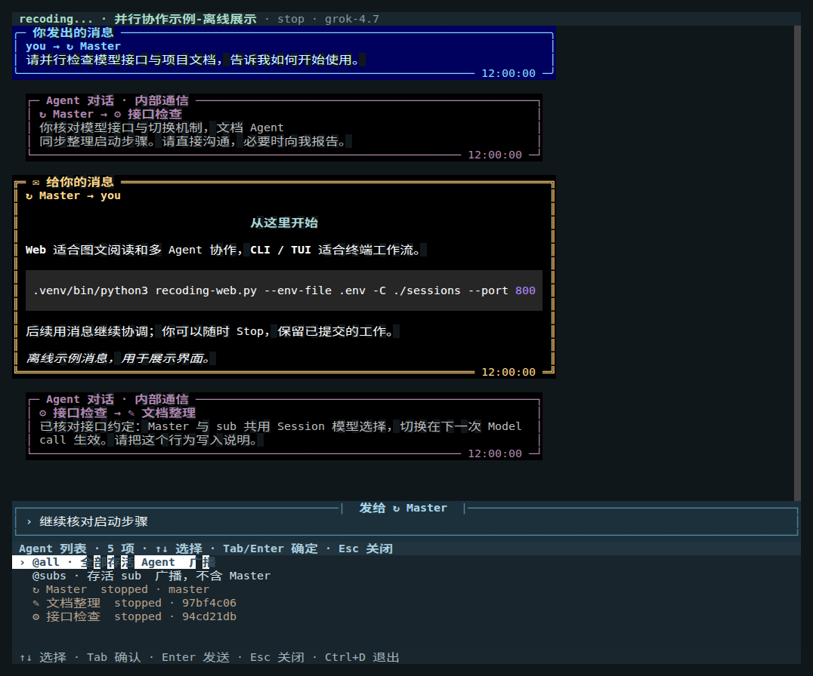

# CLI 与全屏 TUI

[文档目录](index.md)

CLI 位于 `apps/cli/recoding_cli/`，直接调用 `core/session/`，不导入 Web，不启动 HTTP 服务。它和 Web 使用相同的 v5 Session 存档、消息队列、模型协议、工具和 endless Agent loop。交互聊天使用全屏 TUI；Shell 命令仍可独立调用。运行时只显示消息，不输出模型正文、Thinking、工具调用或 Iteration 卡片。

## 界面预览



*截图来自真实 prompt_toolkit 屏幕缓冲区与合成离线消息，不是模型报告。*

## 安装与启动

需要 Linux、Python 3.10+、Bubblewrap、Bash。首次完整环境检查见 [初始化指南](first-run.md)；下面只创建缺失的虚拟环境：

```bash
if [ ! -d .venv ]; then
    python3 -m venv .venv
fi
.venv/bin/python3 -m pip install -e '.[cli]'
```

配置项目时，若根目录没有 `sessions/`，先执行 `mkdir -p ./sessions`。日常在项目根目录直接使用下面这一行，无需激活环境。后续项目的 Python 启动、测试、安装与脚本命令均显式使用 `.venv/bin/python3`：

```bash
# 读取项目 .env；默认 grok-4.7，新建 Session 绑定 ./sessions
.venv/bin/python3 recoding-cli.py chat --env-file .env -C ./sessions
```

省略子命令也会进入 `chat`。未指定 `-s` 时先显示空白输入界面，**只有发送第一条用户消息才创建 Session 并唤醒 Master**；此时才读取模型配置和检查凭据。编辑草稿、查看帮助、选择目录或直接 Ctrl+D 退出，都不创建存档或启动 Agent。创建时才生成默认名字 `session-YYYYMMDD-HHMMSS`；`--name` 可预先指定名字。

`-p/--prompt`、`--prompt-file` 或 `--image` 已经提供了第一条消息，可以直接创建。显式 `create` 是创建请求，仍会立即创建；`chat -s`、`resume -s` 保持恢复已有 Session 的语义。新建 `run` 或 `chat --detach` 必须提供首条消息，避免留下自动创建的空 Session。`.env` 读取中性的 `RECODING_API_KEY`、`RECODING_BASE_URL`、可选 `RECODING_MODEL`，旧 GEMINI 名称仍可用；环境变量优先。`GEMINI_MODEL` 不覆盖新建默认模型。用 `--model` 显式指定，详见 [模型/API](model-api.md)。密钥不作为命令行参数、不写入 CLI 控制文件；默认及显式指定的环境文件在工具沙箱中屏蔽，请通过 `.env` 或环境变量传入。

```bash
# 完全离线的固定响应演示，Python 工具仍在真实沙箱中执行
.venv/bin/python3 recoding-cli.py chat --demo --no-network --no-gpu -C ./sessions/tests/my-cli-demo
```

`--demo` 和目录发现不读取 `.env`；CLI 不提供离线历史浏览或离线留言。Core 仍使用标准库；`prompt_toolkit` 和 `rich` 仅属于 CLI/TUI 外壳：前者负责终端布局与输入，后者负责 Markdown 和代码高亮。Web 不需要它们。

## 交互界面

`chat` 和 `attach` 在终端中打开全屏 TUI。上方是滚动对话区，下方是常驻输入框；输入框默认一行，随文字增加，最多五行后内部滚动。`@`、`/` 及管理命令打开的选择与信息面板均放在输入框下方，不往聊天记录中插入系统卡片，不覆盖草稿或夺取输入焦点。终端缩放时重新排版。

默认显示整个 Session 的**全部人机和 Agent 间消息**。你的输入使用靠右的蓝底圆角卡片，标记“你发出的消息”；Agent 给你的回复使用黑底、金色双线框，标记“给你的消息”；Agent 间通信使用内缩的暗紫色细框，标记“Agent 对话 · 内部通信”。除了颜色，位置、边框和文字标签也不同，关闭颜色时仍能区分。每张卡片保留完整的双方名字、图标和时间。Markdown 标题、粗体、引用、列表、表格与代码块按格式显示，代码按语言高亮。颜色由 TUI 渲染器统一输出，正文不再把 ANSI 转义码打印成 `?[32m` 等文字。

对话在底部时跟随新消息；滚轮或 PageUp/PageDown 翻看历史时保持阅读位置，新消息只增加未读提示。点击“↓ 最新”或 Ctrl+End 回到末尾。管理/错误信息显示在输入区下方，不混进 Agent 消息。底部快捷提示按当前状态切换：未开始时提示输入首条消息和 `/resume`；选择面板打开时提示选择、确认与 Esc；速度图可操作时提示左右键；普通输入且没有面板时不显示无效的 Esc 提示。

| 操作 | 效果 |
| --- | --- |
| Enter / Alt+Enter | 发送 / 换行 |
| 输入 `@` | 在输入框下方选择 Agent、`@all` 或 `@subs`；选择后成为默认收件人 |
| `@master 消息`、`@ID 消息`、`@"名字" 消息` | 只给这一条输入指定收件人，不改变默认对象 |
| 输入 `/` | 显示可选择的命令列表，↑↓ 移动、Tab 或 Enter 选择 |
| `/agents` | 打开 Agent 列表，可点击或选择收件人；停止项可单独留言 |
| `/messages all` / `/messages human` | 全部消息 / 只看人机消息 |
| `/settings` | 打开设置面板，选择模型、并发、休眠、消息范围等 |
| `/help` | 帮助及命令列表 |
| PageUp / PageDown、滚轮 | 翻看对话 |
| Ctrl+Home / Ctrl+End | 已加载对话开头 / 最新消息 |
| `/stop` | 停止整个 Session，输入框继续可用；TUI 中唯一的 Stop 操作入口 |
| Esc / Ctrl+C | 关闭当前面板并保留草稿，不停止 Agent |
| Ctrl+D / `/quit` / `/exit` | 离开 TUI；关闭当前 Session 并释放独占，包括 attach 到的后台 Session |

所有管理命令通过 `/` 输入或其命令菜单执行，不使用功能键，也不提供顶部 Stop 按钮。Ctrl+D 随时正常退出，包括正在编辑草稿或打开面板时；不发送草稿，按 `/quit` 的同一流程保存已提交历史、回收当前运行环境并释放独占。连接既有后台的 attach 界面退出，也停止并关闭该 Session。

鼠标模式下，终端自身的文本选择通常需按住 Shift，具体取决于终端。输入中看到的新消息不会把键盘焦点移走。

| 命令 | 用途 |
| --- | --- |
| `/agents`、`/to master/ID/"名字"/all/subs` | 查看 Agent 或切换默认收件人 |
| `/view all/master/ID` | 查看全部，或只看涉及某个 Agent 的通信 |
| `/messages all/human` | 全部消息 / 只看人机消息；仅改变展示，不改变模型 context |
| `/history 100` | 加载最近 100 条记录，最多 200，不重复插入已有消息 |
| `/speed` | 打开当前 Session 的 Output speed 曲线，包含全部 Agent |
| `/settings`、`/status` | 设置面板、工作目录及 Session 状态 |
| `/processes`、`/python` | 全部 Node 当前 Bash/Python 进程 / 仅 Python |
| `/executions [ID]` | 历史与当前执行记录 / 按 ID 读取日志 |
| `/model ID`、`/max-agents N`、`/sleep SECONDS` | 修改全 Session 模型、sub 并发上限、兜底休眠 |
| `/config model=ID max_subagents=N idle_sleep_seconds=N` | 一次修改多项共享设置 |
| `/attach "图片路径"`、`/clear-attachments` | 添加/清除下一条输入的 PNG/JPEG，最多 8 张 |
| `/stop`、`/wake` | 停止当前 Session 全部 Agent / 唤醒当前 Master |
| `/resume`、`/resume ID或名字或路径` | 打开本目录 Session 列表 / 恢复并切换到指定 Session |
| `/rename "名字"`、`/pin`、`/unpin` | Session 改名、置顶、取消置顶 |
| `/compact`、`/compact cancel [REQUEST_ID]` | 查看后台压缩状态或取消；Agent 继续运行 |
| `/export "文件.json"` | 导出全部通信消息；不覆盖已有文件 |
| `/retry` | 恢复上次发送失败的文字、收件人和附件，确认后再发 |
| `/draft` | 取回进入设置命令前暂存的聊天草稿 |
| `/help`、`/quit`、`/exit` | 帮助、退出（也可 Ctrl+D） |

`/resume` 无参数时在输入框下方依次显示：当前目录直接拥有的 Session、`↰ ..` 返回上一级、当前子目录。Session 用金色与 `◈`，目录用蓝色与 `▱`，选中时仍保留各自颜色；子目录后不附“进入子目录”。↑↓ 到达列表两端后停住，不循环跳转。选择目录只读轻量元数据；选择 Session 才 Resume。用 ↑↓/Enter 或鼠标进入子目录、返回上级；`/resume --directory 路径` 直接定位目录。没有 Ctrl+R 或递归选项，Shell `list` 仍可递归发现。

可直接输入 `/resume ID`、`/resume "Session 名字"` 或完整存档路径。名字/ID 从当前选择目录直接查找；其他目录的 Session 可先导航或提供路径。恢复取得独占并唤醒 Master，sub 保持停止。已经被任一 Host 持有的目标不会被抢占。

CLI 一次只打开一个 Session。切换时先关闭旧 Session、回收它的运行资源并释放独占，再恢复新 Session。草稿、附件、显示范围和阅读位置可按存档保留，但不保留多个运行 Host。`/stop` 关闭当前 Session 后回到未打开状态，可用 `/resume` 再选；CLI 不会转成只读浏览停止存档。

`/wake` 只作用于当前 Session 的 Master，不选择其他 Session、不启动 sub：停止/失败时重建 Master，休眠时发送一条标明 `/wake` 的真实用户消息进入队列，运行中则不重复启动。未打开存档应先 `/resume`，不能用 `/wake` 代替恢复 Session。

Agent 选择列表使用最近一次正常 Model call 的 Input 和“已压缩 ≈”指标；后者是原始历史与当前压缩投影之差的估算，不累加历次压缩量。未知值显示 `—`，完整数字可在 `/status` 查看。创建时间用于排序，不占显示空间。

`/processes` 展示整个 Session、所有 Node 的 Bash/Python 当前资源，顶部汇总 run/ready，历史已关闭进程不展示。每行标明 sync/async、有状态/无状态，以及本次 Execution 的耗时；从 `started_at` 开始计时，排队项显示等待，ready 项显示空闲。Local 不加节点标记，Remote 显示节点名。选择正在调用的进程可读取执行日志；`/executions` 保留当前与历史记录。`/python` 使用同样规则，仅查看 Python。数据来自现有 CLI Host 的数值/资源投影，不执行工具、不读取模型 Context；输入草稿和焦点保留。

输入框的收件人与消息查看范围相互独立：可以给 Master 发消息，同时观看所有 Agent 的通信。`@all` / `@subs` 仅向存活项发送，后端再次复核；单独给停止项留言不恢复它。创建、停止、恢复或改名 sub 仍需发消息让 Master 操作，TUI 不绕过角色权限。

图片在消息中显示完整路径，优先使用所属 Agent 的不可变快照在运行 CLI 的主机上的绝对路径，便于找到实际文件，而不只是显示文件名或 `/workspace` 沙箱路径。没有快照的 Markdown 图片按 workspace 映射为主机路径；外链保留 URL，不自动下载。相同附件与 Markdown 引用不重复列出。JSON 输出保留原始图片元数据。本版本不在终端直接绘制位图，也不把 LaTeX 排成图像。Web 可查看完整图片与公式。用户附件通过核心上传后进入模型图像输入；显示 peer 图片信息不代表模型看到了图片。

stdin/stdout 不是真正终端，或指定 `--format json/jsonl` 时，继续使用逐行 Shell 协议，不进入全屏模式。`run` 的默认流仍只显示人机消息，增加 `--messages all` 可包含 Agent 间消息。

## 输出速度曲线

输入 `/speed`，曲线显示在输入框下方，不挤进对话消息；输入框继续可编辑。图中显示调用散点和合计曲线，横轴为时间、纵轴为 tok/s：

- 每次 Model call 只画散点，点之间不连线；沿用 Web 的模型配色：Grok 紫、Argon 绿、Flash 蓝。每个点是该调用 API 回报的 `completion_tokens / 总耗时`，含等待时间，不是流式解码瞬时速度。
- 底层细线为整个 Session 所有 Agent **相加**的 10 秒平滑估计：将每次调用的 Output 均匀分配到其调用区间，再对并发总速率做最近 10 秒滑动平均。不是 Agent 平均值，不额外把 Thinking 加一次。只有已回报的用量参与；未完成调用不虚构 token，Demo 无用量时显示等待。

数据包括 Master、运行/已停止 sub，以及有实际用量的摘要请求，覆盖整个 Session 历史，不受 `/view` 的消息过滤影响。普通打开 Agent 列表或 Session 导航不会加载这些曲线。

| 命令 | 效果 |
| --- | --- |
| `/speed` | 打开曲线，默认最近 1 小时 |
| `/speed 10m`、`/speed 1h`、`/speed 1d`、`/speed all` | 最近 10 分钟、1 小时、一天、全部 |
| `←` / `→`，或 `/speed wider` / `/speed narrower` | 扩大 / 缩短最近时间窗口，每次乘 2 / 除 2，持续跟随当前时间 |
| `/speed in`、`/speed out` | 放大 / 缩小固定历史窗口 |
| `/speed left`、`/speed right` | 向历史 / 向现在平移 |
| `/speed reset` | 恢复上一次时间预设并跟随当前时间 |
| `/speed off` 或 Esc | 关闭曲线，不停止 Agent |

方向键仅在速度图打开、没有选择菜单且输入框为空时调整最近时间窗口。输入框有草稿时，左右键仍移动文本光标。`←` 扩大窗口，`→` 缩短窗口；最短 1 秒、最长 10 年，短 Session 只显示已经发生的时段。它们与 `/speed wider/narrower` 相同，调整后仍跟随现在；`reset` 返回最近一次时间预设。

预设或方向键调整的最近窗口随当前时间前进，即使没有新的 Model call，时间轴和合计速率仍更新，已知速率会衰减到零；纵轴按当前窗口中的可见线段重新缩放。通过 `in/out/left/right` 缩放/平移后固定历史窗口，不被时钟刷新覆盖。顶部“最近调用”和“合计10s”始终描述 Session 的最新情况，不代表历史窗口末端；时间标签使用 CLI 运行环境的本地时区。

曲线打开时每秒读取当前 Session 的数值缓存；关闭后停止这项读取，不触发模型请求或工具执行、不读取/改变模型 context，也不消费消息队列。终端太小时退化成紧凑数值，放大终端可继续看曲线。

Shell 中可以读取同源的数值样本：

```bash
.venv/bin/python3 recoding-cli.py speed -s SESSION_ID --json
```

未被 CLI Host 持有时，该命令拒绝读取；请先 Resume。目录导航只读轻量元数据，不扫描历史。

## Shell 操作

所有命令支持 `--help`，通用选项可放在子命令前后。`-s` 接受存档路径、ID/唯一前缀或搜索根下的唯一名字。创建与恢复都启动 Master；前台命令退出会关闭 Session，显式 `--detach` 才继续后台运行。

```bash
# 后台创建并唤醒 Master，保存返回的存档路径
SESSION=$(.venv/bin/python3 recoding-cli.py create --env-file .env -C ./sessions --name shell-demo --detach --json \
  | .venv/bin/python3 -c 'import json,sys; print(json.load(sys.stdin)["session_directory"])')

.venv/bin/python3 recoding-cli.py list -C ./sessions --json
.venv/bin/python3 recoding-cli.py status -s "$SESSION" --json
.venv/bin/python3 recoding-cli.py agents -s "$SESSION" --json
.venv/bin/python3 recoding-cli.py processes -s "$SESSION" --json
.venv/bin/python3 recoding-cli.py send -s "$SESSION" --to master -p '请并行分析，再给我发消息。'
.venv/bin/python3 recoding-cli.py send -s "$SESSION" --prompt-file requirements.txt --image input.png
.venv/bin/python3 recoding-cli.py messages -s "$SESSION" --messages all --follow --format jsonl
.venv/bin/python3 recoding-cli.py model -s "$SESSION" gemini-4-argon
.venv/bin/python3 recoding-cli.py config -s "$SESSION" max_subagents=8 idle_sleep_seconds=3.5
.venv/bin/python3 recoding-cli.py rename -s "$SESSION" new-name
.venv/bin/python3 recoding-cli.py pin -s "$SESSION"
.venv/bin/python3 recoding-cli.py export -s "$SESSION" messages.json
.venv/bin/python3 recoding-cli.py stop -s "$SESSION"       # 回收并释放独占

# 恢复并进入 TUI；只启动 Master
.venv/bin/python3 recoding-cli.py resume --env-file .env -C ./sessions -s "$SESSION"
# 或恢复为显式后台 Host
.venv/bin/python3 recoding-cli.py resume --env-file .env -C ./sessions -s "$SESSION" --detach
.venv/bin/python3 recoding-cli.py attach -s "$SESSION"     # 连接现有 CLI Host；退出时也关闭 Session
.venv/bin/python3 recoding-cli.py close -s "$SESSION"      # 关闭 Host，等待独占释放
```

Shell 控制命令使用现有 CLI Host 的同用户私有 Unix socket，不创建第二个 Session 对象；不能通过它读取 Web Host 的 Session。没有 CLI Host 时，历史、消息、配置和编辑操作均拒绝，不退回离线读写。需要只读浏览请使用 Web。

`--to all/subs` 只选择存活项；当前运行 Session 内停止的单个 Agent 仍可留言。sub 的创建/Stop/Resume/改名由 Master 操作。Context 压缩自动在后台启动，`/compact` 或 Shell `compact` 查看状态，`cancel` 取消且不停止 Agent；不再使用人工批准流程。完整存档复制应先关闭 Session，再从文件系统复制；CLI 不提供运行中 `export --archive`。

### 有限脚本驱动

Agent 本身始终循环，不会因为输出正文或发了消息就完成。Shell 可以指定自己的等待条件：

```bash
.venv/bin/python3 recoding-cli.py run -C sessions/tests/shell-task --env-file .env \
  -p '用 Python 计算并保存结果，完成后给我发送 TASK_DONE。' \
  --until TASK_DONE --timeout 120 --format jsonl

# 或等待一条新的 Agent→human 消息
.venv/bin/python3 recoding-cli.py run -C sessions/tests/one-report --demo --no-network --no-gpu \
  -p '检查目录' --max-messages 1 --timeout 30 --format jsonl
```

`--until` 只匹配本次启动后收到的 Agent→human 消息，不匹配用户自己发出的文本、旧历史或模型内部输出。`--max-messages` 同样只计算新的人机回复，不代表任务真实成功；脚本应检查消息与输出文件。条件满足后，前台命令自己拥有的 Session 会关闭并释放资源，存档保留。`attach` 离开时会关闭当前 Session 并释放独占；`run -s` 若只观察一个已有后台 Host，有限观察退出不替其拥有者关闭它，需显式 `stop/close`。只有显式 `--detach` 创建的后台 Host 不随启动命令退出。

`run` 不带等待条件时持续运行；Ctrl+C 停止前台拥有的 Session。`--timeout` 退出码为 124，中断为 130，操作失败为 1，参数解析失败为 2，满足等待条件或正常退出为 0。`--format json/jsonl` 在流式场景都是每行一个 JSON 消息；Session 路径提示、错误和压缩提醒写 stderr，stdout 可直接管道处理。`messages --json` 非跟随模式返回含分页游标的对象。

### 主要参数

| 范畴 | 参数 |
| --- | --- |
| 位置与身份 | `-C/--workspace`、`-s/--session`、`--name` |
| 模型/API | `--env-file`、`--model`、`--base-url`、`--api-timeout` |
| 工具环境 | `--execution-mode sandbox/host`、`--tool-timeout`、`--max-output`（工具输出字符上限）、`--network/--no-network`、`--gpu/--no-gpu` |
| 调度 | `--max-agents 0..99`、`--idle-sleep 0.1..3600`、`--detach` |
| 消息 | `-p/--prompt`（可重复）、`--prompt-file FILE/-`、`--image`（可重复）、`--to master/ID/name/all/subs` |
| 展示/脚本 | `--messages human/all`、`--agent ID/name`、`--history 0..200`、`--format text/json/jsonl`、`--no-color`、`--no-timestamps` |
| 等待 | `--until TEXT`、`--max-messages N`、`--timeout SECONDS` |
| 消息分页 | `messages --before ID/--after ID --limit 1..200`，或 `--follow` |

新建参数写入 Session 设置。`--execution-mode sandbox|host` 也会在显式恢复时保存，只能先关闭再切换；Host 不兼容 `--no-network/--no-gpu`。详见 [执行模式](execution-modes.md)。已有 Session 的 API/沙箱启动参数只对本次打开有效；用 `config/model` 持久保存模型、并发和默认休眠。已有 CLI Host 运行时，用 `attach` 进入，或用 `config/model` 修改这三个动态设置；`run/chat/resume` 拒绝重复持有，不会重启已有环境。其他启动参数须先 `close` 再打开。

## Session 所有权和安全边界

`CliSessionHost` 使用公共 `SessionHostProtocol` 取得进程级 `host.lock`；一个 Session 只能被一个 Web 或 CLI Host 持有，运行排斥其他 Host 浏览。内核锁随进程死亡释放，不删除锁文件。Agent/worker 的 `owner.lock` 单独保护实际资源回收。直接 Python Session API 的测试/实验不是 Host，默认不参与这一协议。见 [完整 Host 协议](session-ownership.md)。

CLI 控制通道位于用户专属、0700 的临时目录，socket 0600，并校验同 UID。它属于 CLI 应用，不是额外的核心服务。控制文件不保存 API key；显式 .env 路径仍对沙箱隐藏。

## 验证

```bash
PYTHONPATH=tests .venv/bin/python3 -m unittest test_tui test_cli test_architecture -v
```

测试使用本机 HTTPS/SSE 模型替身或 Demo、真实沙箱和隔离 Unix socket，不读取真实 `.env` 或访问外部模型。验证 Markdown/颜色、固定输入框、下方菜单、终端缩放、历史阅读锚点、默认 peer 消息、@ 路由、设置、中文全屏终端及原 Shell JSONL。测试数据位于专用 `sessions/tests/`；测试结束后先关闭全部运行资源，再自动清空其中内容，需要保留的脱敏报告另存 `.recoding/maintenance/`。

## 后台任务

TUI 输入 `/executions` 列出当前查看 Agent（未限定时使用收件人）的 Execution；`/executions ID` 展示分段日志，下方可选择继续读取。任务不会因打开面板而停止，草稿和输入焦点保留。Bash 和 Python 执行均为 non-builtin；Bash/Python 默认临时执行，也可显式创建持久进程复用状态；日志、取消与恢复规则见 [代码工作能力](coding-tools.md)。

`/processes` 汇总各 Node 当前 run/ready 的 Bash/Python 进程，`/python` 仅展示 Python；`/executions` 可查询本 Session 的完整 Bash/Python 执行记录。它们是只读查看，不启动解释器。Python 资源管理由 Agent 使用三个 [Pool 工具](python-pool.md) 完成。
