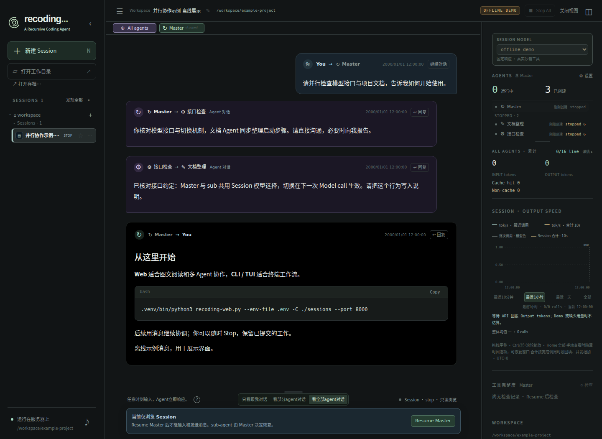

# Web 与 Session 使用

[文档目录](index.md)

Recoding 是 endless multi-agent：每个 Agent 持续 Model call → Tool batch → Model call，无 Turn/最终回答。用户与 Agent 通过消息交互，不需要等待空闲输入阶段。

## 界面预览

*真实界面对合成离线消息的只读展示，不是实际模型报告。*

Web 启动命令见 [配置与启动](configuration.md)，第一次安装见 [首次初始化](first-run.md)。

## 执行模式

新建 Session 可选择 Sandbox（默认）或 Host（当前用户权限、无隔离）。右栏 AGENTS → 设置显示当前模式；只有 Stop 后的只读视图能暂存不同选择，Resume 成功后生效并保存。运行中的 Session 不能切换。Host 的真实路径、凭据可见性及回收限制见 [执行模式](execution-modes.md)。

## Session 与运行

左侧以紧凑的常规字重展示服务器 workspace 目录层级，每个可见目录的 `+` 都能创建 Session。工作目录的一级子目录默认全部显示；更深层默认只显示含 Session 的分支（包括通往更深 Session 的必要父目录）。每个目录下可用 `Display non-session folders / Hide non-session folders` 显示或隐藏它的无 Session 子目录，再逐层浏览和创建 Session；该切换只影响本目录，不改变其他目录的显示选择。

启动或刷新发现新增、移动的 Session 时，自动展开所在目录及必要父路径，使 Session 可见。没有新发现时保留你的主动折叠；有新发现再展开对应路径，失去全部 Session 的旧分支会收起。普通目录按需读取直属子目录；目录和 Session 的增删/移动动态同步。Session 支持改名、置顶、删除和移动，未打开项只加载轻量导航信息。内部 `.recoding` 容器和软链接不出现在树中，不递归加载包目录的全部内容。

点击 SESSIONS 旁的“发现全部”，会重新同步并展开所有含 Session 的路径，覆盖原来的手工折叠，让已有 Session 全部可见。普通无关分支不因此展开；不打开或恢复 Agent，也不加载所有对话历史。

新建只填写名称、模型、服务器工作目录，默认联网/GPU 允许（仍受服务器启动参数限制）。名称默认 session-当前时间。右栏 AGENTS 的 **⚙ 设置** 默认折叠，点击后修改并发上限与空闲休眠；切换 Agent 不收起，打开另一 Session 时重新折叠。并发上限直接输入 0–99 的整数，默认 16，不含 Master；降低不停止现有 Agent。空闲休眠直接输入数字，支持 0.1–3600 秒的小数，默认 10；两项均无上下步进箭头。这只是无工具响应时的兜底，模型可主动指定其他 sleep 时长。列表上方醒目显示 **运行中** 与 **已创建** 数量，均含 Master；运行中含启动、执行、休眠及停止回收阶段，已创建还包含停止/失败项，Resume 不重复计数。右栏从 Session Model 开始，依次展示 Agent、累计、速度与工具完整度；侧栏显隐仍由主界面顶栏按钮控制。

“打开工作目录”切换服务器导航根，不操作浏览器文件系统，不改变已运行 Agent 的 workspace。删除 Session 关闭其运行环境并删除存档/日志/图片，工作文件、安装包及其他 Session 保留。同版本 Session 关闭后可整体移动，工作文件需要另行移动。

当前仅展示 recoding.session v5；旧 v4 及更早存档保留，不转换、不恢复，见[格式策略](migration.md)。

## 消息与图片

每个 Agent 页都有输入框，用户只能一对一发给当前 Agent。默认约 24px 的一行，内容增加时自动长高，默认最多 160px，再多在框内纵向滚动；上方手柄可调整这个最大高度。输入区始终显示，不提供收起按钮。小号发送按钮和文本同排；“任意时刻输入，Agent立即响应。”文案及帮助、细节开关和运行状态在上方分组排列。Enter 发送、Shift+Enter 换行，支持中文输入法和剪贴板图片；正文内嵌的本地图片由服务器自动快照传输，不再重复作为附件展示；素材上传到服务器，发送成功后才进持久队列，不弹出入队提示，发送失败仍提示。草稿和高度上限按 Agent 保留。用户也可给停止或失败的 Master/sub 留言及粘贴图片：消息持久保存为未读，恢复后读取，发送不会自动恢复或启动 worker。Agent 间消息仍在 stopping/stopped/failed 时拒收、不入队。

Agent 使用 send_user_message 给你报告、询问、说明阻碍和交付结果。醒目的人机消息支持 Markdown、公式、代码高亮和图片。Master 和 sub 页面都只显示该 Agent 自己的人机消息；其他 Agent 的消息到对应页面查看。查看 Master 不会把 sub 的消息标为已读，未读提示保留到你进入相应页面。

System prompt 要求 Master 为自己和每个 sub 选择不同的角色图标（含停止项），由 Master 判断和维护，代码不检查或禁止重复。图标在 tabs、列表、消息署名、All agents 和 @ 接收者中统一展示。随时给 Master 发消息即可要求修改任意 Agent 的图标；改动立即同步显示，并在 Stop/Resume 后保留，不影响其身份和历史。

Agent 之间可一对一、群发和广播图文。可选择只看人机消息、同时看 Agent 间聊天、或打开全部细节；你无需阅读普通模型输出即可知道必要事项。运行中的输入在下一次 Model call 读取；休眠会被消息立即唤醒，正在执行的调用不被中途改写。

所有展示图片都由服务器存快照并通过 HTTP 传输，浏览器不依赖服务器本地路径。原文件删除后快照仍可显示。给人看不等于给模型看：模型输出及 Agent 消息中的图片不自动加入视觉 context；模型需要时调用 view_image。用户粘贴图片与主动 view_image 的真实字节才进入 context，并在后续模型调用、跨模型和 Resume 中保留。

## sleep、停止和恢复

sleep 是消息可唤醒工具：已有或新到的任何自身未读消息都会立即返回，不等满指定时间。它不消费正文，下一 Model call 前统一接收。自身消息等待使用 sleep；Master 的全局消息观察是另一组可选工具。模型未返回工具时，系统补一条默认 sleep，明确显示 System 来源；模型主动 sleep 显示模型来源。

| 状态 | 含义 |
| --- | --- |
| starting | 建立 worker、沙箱与 context |
| running | 模型调用或普通工具执行 |
| sleeping | sleep 等消息或超时，仍占并发名额 |
| stopping | 中断调用并回收资源 |
| stopped / failed | 已停止或故障，可恢复 |

顶部 Stop 从当前 Session 的任意 Agent 页停止全部 Agent、关闭该 Session 并释放 Host 独占，始终可见。打开已有 Session 默认仅浏览，只读浏览时，提醒覆盖输入区并禁止输入；已有草稿保留。点击 Resume Master 后恢复输入并唤醒 Master，由它决定恢复哪些 sub。浏览或刷新网页不会启动停止项。普通文本不停止 Agent，也不自动传给用户或 Master。Resume 恢复完整对话、图片、队列和设置，Python/Bash 重新启动，不恢复旧变量/线程/GPU 对象或重放代码。

## 展示和统计

人机消息按实际发送顺序展示，使用独立对话样式：你发送的消息是靠右的暗蓝气泡，Agent 的回复是纯黑背景，页眉只保留名称和时间。发送记录保留原位；在下一次 Model call 读取时，正上方另加 READ 回执，可展开查看内容并跳回原消息。模型生成期间收到你的消息，其发送记录保持原位；模型返回的本步说明归属对应的 Model call 卡片，不移动用户消息。历史回放保持这个顺序，不把所有报告集中到顶部。

输入区上方提供三档，首次默认为“看Agent之间对话”，之后按当前 Session 的当前 Agent 分别保存选择：

| 档位 | 显示内容 |
| --- | --- |
| 只看跟我对话 | 你与当前 Agent 的双向消息 |
| 看Agent之间对话 | 人机消息，加上当前 Agent 与其他 Agent 的聊天 |
| 看更多细节 | 再显示模型输出、Thinking、工具、系统消息和 READ 回执 |

Agent 聊天采用与人机对话一致的正文排版，直接显示 Markdown、公式、代码高亮及服务器图片；当前 Agent 为 **me**、消息靠右，其他 Agent 为 **others**、消息靠左，标明双方名称。Peer 使用纯色暗紫背景，区别于用户发送的暗蓝气泡和 Agent 回复用户的纯黑背景。成功发送后在原位置生成聊天卡；收到消息时生成接收卡，消费它的 Model call 上方另放精简 READ 回执，不重复正文。群发/广播显示实际接收方。

在“只看跟我对话”和“看Agent之间对话”中，toHuman 回复前保留“展开此前细节”，查看从上一条用户消息到该回复的过程；用户消息后保留“展开后续细节”，范围到下一条用户消息，最新一段持续包含新过程。Agent 间聊天卡不添加这些按钮。局部展开只改变原位置节点的可见性，重叠范围以最后一次操作为准；收起不会隐藏该档位本来就展示的人机消息或 Agent 聊天。点击任一档位，包括再次点击当前档位，会收起局部展开，恢复该档位的默认视图。

三档切换保留消息顺序：若在末尾就继续显示末尾，在中间阅读则尽量保持可见对话的位置，无滚动动画。回复前展开时定位到相关过程开头，收起时尽量保留按钮所在的对话边界。局部展开、草稿、粘贴图片、最大输入高度按当前 Session/Agent 保留，切页和历史回放不相互影响；右栏模型、并发上限和默认 sleep 仍是整个 Session 的配置，顶部 Stop All 与输入框上方的 Resume Master 保留其全局生命周期作用。

向上翻阅后，对话右下角会出现“↓ 最新”，点击直接回到当前 Agent 的对话底部。“某 Agent 给你发来消息”的通知可点击或用键盘 Enter 打开，自动切换到发送者页面并定位对应原消息；必要时补载更早记录。“看更多细节”中的 Model call 卡片醒目显示“本步说明”，较长输出默认预览四行、可展开完整图文正文；Thinking 保持独立的两行预览、可展开全文；原始发送参数和投递记录在工具的次级详情中。展示聊天或展开细节不会把消息图片加入模型 context，也不会把普通模型输出变为发给用户的消息。

中间按一次启动的 Run 分组，Iteration 是 Agent 终身模型调用序号。System 要求每次模型响应都附一至两句简短说明，包括工具调用和休眠：概括本步观察、判断及接下来要做的操作，不把尚未执行的工具说成成功。工具调用另带模型生成的简短说明字段；某些网关只返回工具而不返回正文时，卡片显示这个说明，正常正文优先，不重复展示。说明字段执行前会从参数副本剥离，不作为真正工具的输入，也不增加模型调用。普通模型文本在所属 Model call 卡片内按 Markdown/公式/图片显示，属于可隐藏细节，无最终粗黄线或 DONE；它不会代替显式发给用户的消息。工具/收件卡均按真实执行顺序；人机消息与 peer/系统/管理卡配色区分。停止卡保存该 Run 汇总。

右栏依次为 Session Model、Agent 列表、All Agents 累计、Session Speed、workspace/Session archive。Master 固定顶部，其后活跃与停止/失败分组，各组按创建时间降序，行内不显示创建时间。每项紧凑显示最近一次 Model call 的 API Input tokens 和“已压缩”的 token 量估算，悬停查看完整数字与口径；没有记录显示 —。列表内部滚动且高度可调；顶部是 Master、活跃 sub 及当前查看的停止 sub，最多两行后纵向滚动。

## Context、统计与工具检查

Context 接近预算时，Session 自动后台压缩；右栏最上方显示目标 Agent、状态和取消按钮，不影响正在执行的任务。摘要成功后在下一次 Model call 使用，失败或取消保留原上下文。规则见 [模型 Context](context.md)。右栏累计用量与速度见 [运行观测](observability.md)，工具评分与刷新见 [工具完整度](tool-inventory.md)。

## 连接和诊断

隐藏网页释放 SSE 并暂停轮询，不停止服务器 Agent。恢复可见时校验实例并补事件；服务重启后旧页提示重连。同页一个 Session SSE，sub 共用。输入输出时间取原服务器 timestamp，不以回放时间替代。

Model call 详情含 HTTP、headers、首输出/首文本、request ID、context 大小及重试。API 错误最多追加 3 次重试，工具不重放；达到上限进入 failed，已提交记录保留。完整 context 在 Session runs 中，脱敏服务日志在启动目录 .recoding/server-logs/。Markdown/公式/高亮使用本地资源，不依赖 CDN。

## All agents 消息汇总

点击消息发送者的头像图标，或署名中的图标/名称，会打开该 Agent 的 tab，并停在同一条消息上。早期历史按消息 ID 自动补载；群发消息定位到发送者的原始发送卡片。若目标 Agent 当前只看人机对话，跳转仍会单独展开这条 Agent 间消息，不改变保存的显示档位；再次选择显示档位可恢复该档基线。跳转仅浏览记录，不启动或恢复 Agent。

顶部 **All agents** 汇总当前 Session 的所有人机消息及 Agent 之间的消息，按发送时间排列。它只展示消息，不展示模型输出、Thinking、系统通知或 Model/Tool call 卡片，也没有局部“展开细节”按钮。较早消息按需加载；同一批群发合并成一张卡片，显示实际接收者，收件箱中的各条消息保持独立。Markdown、公式、代码和图片使用与单 Agent 页相同的格式化显示，图片从服务器对应 Agent 的快照传输。

选择“看全部agent对话”时也同时保留人机消息。Master 存活时默认给 Master；输入框左侧的 **@** 只列出 starting/running/sleeping 的 Agent。两个并列群发选项为 **@all**（全部存活 Agent，含存活 Master）和 **@all（除了 master）**（全部存活 sub）。stopping/stopped/failed 不在列表或群发接收者中，服务端发送时再次校验，发送期间刚停止的群发目标会被跳过；没有存活接收者时禁用发送。若要给已停止 Agent 留言，进入它的单独页面发送，不会自动恢复。粘贴图片会由服务器复制到实际接收者的图片资产及工作区；只有这些真实接收者才会在读取该用户消息时将图片加入模型 context。

显示选项依次为 **只看跟我对话**、**看部分agent对话**、**看全部agent对话**。点击第二项打开条件面板，提供 **发送者** 和 **接收者** 多选；候选只有你和当前 starting/running/sleeping 的 Agent。选择“全部”时所有方块均勾选，取消某个人则排除该项。同一栏多选取“或”，两栏之间取“且”；例如发送者选 A、B，接收者选你，只显示 A 或 B 发给你的消息。**你自己发送的消息始终显示，不受筛选限制。** 接收者按实际投递对象匹配，抄送副本也算；群发卡片仍保留完整接收者署名。“全部”仍包含历史消息，不隐藏已停止 Agent 的旧记录。筛选只作用于已加载消息，较早记录仍可按需加载；切回“只看跟我对话”或“看全部agent对话”暂不应用筛选条件，回到“看部分agent对话”继续使用上次选择。

每条 Agent 消息都有 **回复** 按钮：点击后直接聚焦输入框，自动选择该发送者为 @ 接收者，不改写草稿、不自动发送。已停止 Agent 会打开它的单独页面供留言，不自动恢复；只读 Session 仍需 Resume 后才能发送。你自己发出的消息显示 **继续对话**，可继续给原接收者发消息。

All agents 的草稿、接收者、显示档位和筛选条件按 Session 独立保存，切换单 Agent 页不改变该 Agent 的输入目标。筛选只影响页面显示，不改变 context、消息投递或存档；汇总读取不消费任何模型收件箱，也不启动额外 Agent 或 SSE 连接。

新消息不再强制跳到最新位置；正在阅读的内容保持原位。需要追到末尾时点击 **↓ 最新**。点击顶部消息提示仍会定位到对应 Agent 的具体消息。

Web 只读浏览与进程 Host 的边界、GUI 单页面接入及 CLI 单 Session 生命周期，见 [Session Host 协议](session-ownership.md)。

品牌图形和截图来源见 [品牌资源](branding.md)。

## 后台任务

右栏 PROCESSES 统一显示整个 Session 的当前 Bash/Python 资源，每个进程一行：run 为正在执行/启动/排队/取消等非终态，ready 为保留状态但当前没有工作的持久进程。标题显示两类数量；面板默认折叠，展开后紧凑显示，底部手柄可上下调整高度，列表内部滚动。临时执行完成即移出；持久进程完成工作后保留为 ready，关闭后移出。不展示历史项，日志与历史记录仍保留。每行另标当前调用 sync/async 和有状态/无状态；计时从本次 Execution 的 started_at 起算，不含排队或进程此前存活时间，每秒更新。未开始时标排队中/启动中，ready 显示空闲和 —，不沿用旧调用的模式与耗时。展开运行行可通过服务器接口分段读取当前执行输出；刷新不丢展开位置与读取游标。Python/Bash 的 Agent-loop 调用卡标题另有 sync/async 标记，省略 mode 时为 sync。详见 [编辑、Job 与导航](coding-tools.md)。

## Session 计算节点

右栏顶部 SESSION RESOURCES 合并模型与 Remote nodes。Local 固定必选且不列为选项；点击 + 添加 SSH 节点并指定其目录，列表可连接/移除。节点配置作用于整个 Session；普通本地调用不加标签，远端调用显示节点名。浏览停止存档不启动节点，需 Resume 后操作。详见 [计算节点](nodes.md)。
